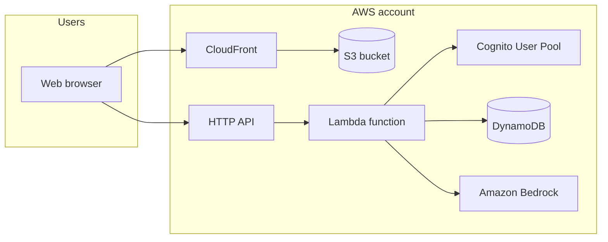
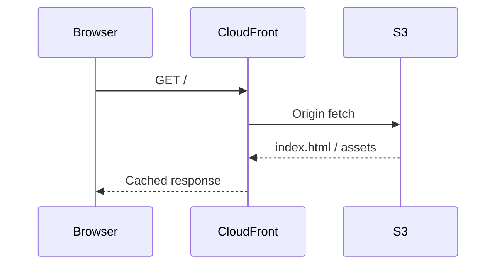
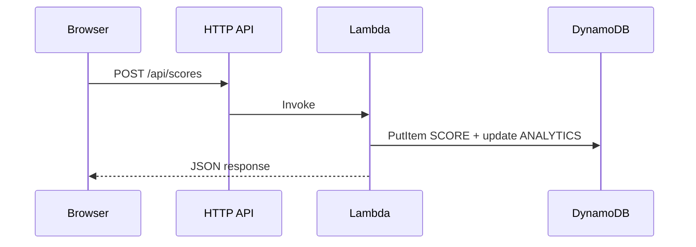

# AWS architecture

This project runs as a **static single-page application (SPA)** on **Amazon S3** and **CloudFront**, talking to a **serverless API** on **API Gateway HTTP API** and **AWS Lambda**, with **Amazon Cognito** for authentication and **Amazon DynamoDB** for data. Optional **Amazon Bedrock** calls power AI coaching and practice passages.

Diagrams use [Mermaid](https://mermaid.js.org/) syntax; they render on GitHub and in many Markdown viewers.

---

## 1. High-level system context

- **CloudFront + S3:** Hosts the built React app (`index.html`, JS, CSS). SPA routing returns `index.html` on 403/404 so client-side routes work.
- **HTTP API + Lambda:** Single Lambda handles all API routes (users, scores, analytics, coaching, health). Routing is by path inside the handler.
- **Cognito:** Email-based sign-up and sign-in; the SPA receives JWT **ID tokens** and sends them as `Authorization: Bearer …` to protected routes.
- **DynamoDB:** Single-table design (`pk`, `sk`) with one GSI for global leaderboard queries on scores.
- **Bedrock:** Invoked only for AI features (optional); see [AI coaching and practice passages](./ai-features.md).

---

## 2. Request paths

### 2.1 Static site

### 2.2 API (example: submit score)

### 2.3 Protected routes

Routes that require a logged-in user decode the **JWT** in the Lambda (Bearer token). There is no API Gateway authorizer in the current design; authorization is enforced in application code.

---

## 3. Infrastructure stack (CDK)

A single CDK stack defines the environment:

| Stack name | Typical use |
|-------------|-------------|
| `typing-speed-dev` | Single environment |

The stack creates the Cognito pool, DynamoDB table, Lambda, API, S3 bucket, and CloudFront distribution.

**Source:** `infra/lib/typing-speed-stack.ts`, entry `infra/bin/typing-speed.ts`.

---

## 4. DynamoDB data model (conceptual)

Single table; partition key **`pk`**, sort key **`sk`**.

| Pattern | `pk` | `sk` | Notes |
|---------|------|------|--------|
| User profile | `USER#<cognito-sub>` | `PROFILE` | Created on email confirmation |
| Score | `USER#` | `SCORE#<ISO>#<uuid>` | GSI1: leaderboard |
| Analytics aggregate | `USER#` | `ANALYTICS` | Rolling stats, derived fields |
| AI coaching cache | `USER#` | `COACH` | Optional `ttl` |
| AI passage cache | `USER#` | `PASSAGE#…` | Optional `ttl` |

Global secondary index **`gsi1`**: items with `gsi1pk = SCORE` and `gsi1sk` = timestamp support querying recent global scores for the leaderboard.

---

## 5. Network and security notes

- **CORS:** HTTP API allows configured headers and origins for browser calls (see stack).
- **Secrets:** No database passwords in the client; Cognito handles credentials. API URLs and Cognito IDs are **public** in the built SPA; protect accounts with strong passwords and Cognito policies.
- **Bedrock:** Model access must be enabled in the Bedrock console for your account/region; IAM allows `bedrock:InvokeModel` on the Lambda role.

---

## 6. Deploy and environment variables

Operational steps (bootstrap, `cdk deploy`, uploading the build to S3, CloudFront invalidation, Vite `VITE_*` variables) are documented in **[infra/README.md](../infra/README.md)**.

Typical frontend build-time variables:

| Variable | Purpose |
|----------|---------|
| `VITE_API_URL` | Base URL of the HTTP API |
| `VITE_COGNITO_USER_POOL_ID` | Cognito User Pool ID |
| `VITE_COGNITO_CLIENT_ID` | Cognito app client ID |
| `VITE_AWS_REGION` | Region string for the Cognito client |

---

## 7. Further reading

| Document | Topic |
|----------|--------|
| [Typing analytics](./analytics.md) | Keystroke aggregates, DynamoDB analytics profile, Analytics UI |
| [AI coaching and practice passages](./ai-features.md) | Bedrock, coaching cache, drill passages |
| [infra/README.md](../infra/README.md) | CDK commands, deploy checklist |
